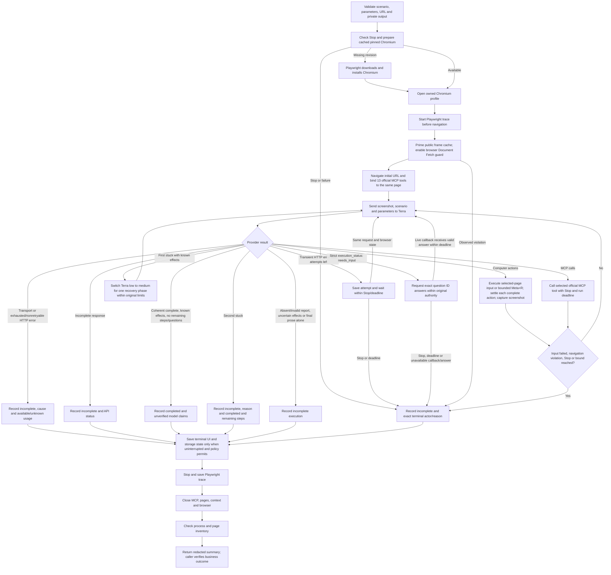

# Terra computer Runner flow

The original request stays immutable; an answer delivered to the live callback
continues the same worker, browser and provider history. A retained answer receipt
does not prove delivery or continuation. Waiting consumes the original deadline.
Missing input does not consume the escalation. Errors, uncertain effects, safety
conditions, Stop, deadline and exhausted limits do not trigger automatic recovery
or replay. Terminal capture is skipped after Stop or deadline; the manifest records
that skip. Otherwise it is attempted before cleanup. The trace covers Chrome and
Playwright, while the model API runs in
Node. Actions and model-authored step/completion reports do not establish an
application outcome; the caller independently observes it.

Sensitive answers use optional `sensitiveQuestionIds` in the callback return.
It lists unique exact answered IDs; omission adds no sensitivities. Registered
values protect later public content, including retained reads after restart;
private originals and correlation IDs stay unchanged.

Stop, deadline and uncertain effects dominate before the terminal decision.
Accepted execution disposition is frozen before capture/cleanup. Cleanup crossing
a deadline or observing a later Stop is recorded separately and does not convert
accepted completion into contradictory incomplete execution.

Native screenshots and inputs require a live selected owned page. Explicit sequential default-context tab operations reconcile generated MCP Result indices with known page identities. Unexpected lifecycle changes or ambiguous metadata leave native input unbound. Native screenshots and inputs address the page viewport. Exactly Meta+R runs one direct browser refresh on the selected owned page, with Stop and the remaining deadline. It sends no page key event; page keydown cancellation does not apply. Other keys stay literal. Stop is not rollback of an effect that has already started.

The browser Fetch guard is ready before initial navigation and checks Request-stage Document redirects. Allowed-host requests continue unchanged. A disallowed document requires a cached positive child/parent chain; known roots and unknown attribution block. Frame snapshots are taken before interception, never while a document is paused. Public frame events retain logical OOPIF swaps and invalidate removals. The route and navigation latch remain: violations stop later provider dispatch, actions and returned observations, and skip terminal page-content capture. Fetch stays active until owned browser closure. Pre-decision failures remain terminal. After the work decision, later guard/Stop/deadline/capture observations are retained separately without changing accepted disposition or cause. Known subframes and non-document assets remain permitted. Earlier tracing or MCP capture can exist; bounded loopback prevention evidence is not universal network or capture containment. See the README for tested paths and explicit limits.

Each complete top-level computer action has a fixed 250 ms settlement before the
next action. Compound click, modifier and drag events stay atomic. An empty
computer call keeps one settlement; a nonempty call has no extra batch wait.
Stop, deadline and navigation-guard failure interrupt settlement; selected-page
and navigation guards apply before further dispatch. Completed input receipts
remain completed when a later wait stops the batch. The original provider list
and action rows distinguish the dispatched prefix from the undispatched suffix.
One screenshot is returned at the end of the call. This finite timing mitigation
does not establish target readiness; a menu delayed beyond it can still be missed.

## Disposable profile cleanup

After verified browser/process cleanup, Runner removes only the exact fresh
profile it created. It checks the directory and parent identities before moving
the profile into a private holding directory, then checks its identity again
before removal. Uncertain cleanup, replaced paths and unknown ownership keep the
profile. Saved captures, storage-state snapshots, trace, operation records and
evidence manifests stay intact.

Trusted diagnostic hosts can set `RunOptions.browserProfileDiagnosticConsumer`
to a nonempty name (letters, digits, `.`, `_`, `:` or `-`, up to120 characters)
to retain a profile for inspection. This is not a model or public MCP option.
The private cleanup record states whether the profile was removed or retained.
Retirement does not change the frozen execution result or the browser/process
meaning of `cleaned`. Failed removal preserves the remaining profile for diagnosis.
